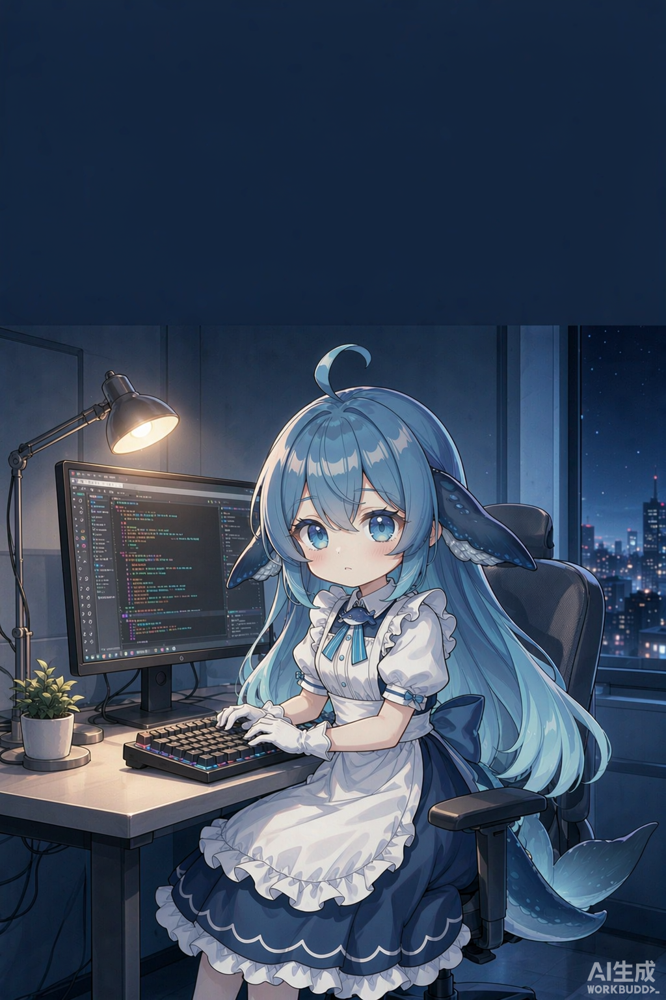

# 直播舞台 · 三窗口 + 虚拟形象



> 给「真实桌面操作」的直播做一层覆盖画面：真实窗口在桌面摆着，虚拟形象、弹幕和字幕以**透明悬浮窗**直接盖在桌面上。
> 纯本地运行，不依赖 OBS，不需要采集插件。

[](LICENSE)
[](#环境)
[](#环境)
[](#许可与使用限制)

> ### ⚠️ 仅供学习与研究，禁止商用
> 直播打赏、带货、付费课程、企业内部使用等**均属商业用途**，不在授权范围内。
> 详见文末 [许可与使用限制](#许可与使用限制)。

<br clear="right">

给「真实桌面操作」的直播做一层覆盖画面：真实窗口在桌面摆着，虚拟形象、弹幕和字幕以**透明悬浮窗**直接盖在桌面上。

```
┌──────────────────┐ ┌────────────┐ ┌────────────┐
│ ● 大肥鱼的直播间 · 我在写代码 · 直播标题…          LIVE│
│ 正在写代码        │ │            │ │            │
├──────────────────┤ │ 网站窗口    │ │ 微信窗口    │
│                  │ │ （实时注册）│ │ （真实聊天）│
│  ZCode 窗口       │ │            │ │            │
│  （Agent 写代码） │ │            │ │    🐳立绘   │
│                  │ └────────────┘ │            │
│                  │ ┌────────────┐ │            │
│ 大肥鱼：诶我在弄…  │ └────────────┘ └────────────┘
└──────────────────┘
```

三个取景框里全是透明的 —— 悬浮层盖在最上面，只留框线和文字，采集工具采到的是「桌面窗口 + 舞台」的合成画面。

## 环境

Windows 10/11 + Python 3.12。装依赖：

```bash
pip install -r requirements.txt
```

| 依赖 | 用途 |
|---|---|
| `windows-capture` | 按窗口句柄采集真实窗口画面（合成器，不靠 OBS） |
| `pywebview` | 透明置顶悬浮窗 |
| `sounddevice` | 语音直接推到 VB-Cable，观众只听到她 |
| `opencv-python` / `numpy` | 画面合成、比例守护 |
| `Pillow` | 截屏预处理、立绘切帧 |

依赖之外只剩两样东西，其中只有一件需要你动手：

**1. VB-Cable 虚拟声卡（必装，手动）** —— [vb-audio.com/Cable](https://vb-audio.com/Cable/)，免费版够用。装完在系统声音设置里能看到 `CABLE Input` / `CABLE Output`。接线三步见 [`开播指南.md`](开播指南.md)。

**2. 抖音弹幕抓取工具（不用手动装）** —— 首次运行 `run.py` 会自动从上游拉取
[jwwsjlm/douyinLive](https://github.com/jwwsjlm/douyinLive)（MIT）的 Windows 包（约 13 MB），
校验 sha256 后解压到 `tools/douyinLive/`，然后直接拉起。

也可以提前单独跑：

```bash
python tools/fetch_douyinlive.py          # 缺才装（幂等，已装则跳过）
python tools/fetch_douyinlive.py --check  # 只看状态，不下载
python tools/fetch_douyinlive.py --force  # 重装 / 升级到最新
```

- 解压时**不覆盖**你自己的 `config.yaml`
- 平台自适应：Windows / Linux / macOS，x64 / arm64
- 下载不通时用 `DOUYINLIVE_VERSION=v2.3.2` 锁版本，或 `DOUYINLIVE_URL=<压缩包直链>` 换源
- 只支持 Windows 的场景请忽略 Linux/macOS 分支（本项目主流程依赖 Windows 窗口采集）

## 开播流程（三步）

**1. 配密钥** —— 复制 `.env.example` 为 `.env`，填 `MIMO_API_KEY`（语音）和 `VISION_API_KEY`（识图，DeepSeek）。已设的环境变量优先，不会覆盖。

**2. 起服务**

```bash
python run.py --mode auto          # 舞台 + 悬浮层 + 布局守护 + 自动旁白
python run.py --mode all --ws ws://127.0.0.1:1088/ws/房间号    # 再加弹幕桥
python run.py --mode stage         # 只要舞台，手动推台词
```

Ctrl+C 一次停掉所有子进程。`run.py --mode auto` 会自动摆好三个窗口（`windows_layout.py`），并在后台守护不让它们跑偏。

**3. 直播伴侣接线** —— 抖音直播伴侣 → 添加素材 → **显示器采集**（全屏）→ 开播。悬浮层会被一起采进去，不需要任何插件。

> 注意：OBS 在本机（Y7000P 混合显卡）采集黑屏，已弃用。悬浮层方案不依赖任何采集软件。

| 入口 | 地址 |
|---|---|
| 舞台（OBS 用，透明） | `http://127.0.0.1:8790/stage.html` |
| 舞台（带假内容预览） | `http://127.0.0.1:8790/stage.html?demo=1` |
| 隐藏取景框 | `http://127.0.0.1:8790/stage.html?noframes=1` |
| 控制台（推台词 / 发弹幕 / 点歌） | `http://127.0.0.1:8790/panel.html` |

## 闭环：它自己会说、会唱、会回

整条链路是这样转的：

```
截屏 → Agnes 看懂画面 → DeepSeek 写一句口语
      → /api/say → 立绘换口型 + TTS 出声 + 字幕
                                   ↓
抖音弹幕 → 抓取工具 → ws → 弹幕桥 ─┬→ 显示在舞台上
                                   ├→ 命中「唱歌/点歌」→ 生成两句原创歌词 → /api/sing → 唱歌
                                   └→ 其他 → 模型应答 → /api/say
```

| 环节 | 谁负责 | 触发 |
|---|---|---|
| 自动解说 | `narrator.py` | 每 90 秒看一次屏幕，画面没变不说 |
| 自动应答 | `douyin_bridge.py --auto-reply` | 每条弹幕，全局 25 秒一次 |
| 点歌 | 同上，默认开 | 弹幕含「唱歌/唱一/唱首/来一首/点歌」，全局 120 秒、同一人 90 秒一次 |
| 日常动作 | `stage.js` | 待机时 7–18 秒随机挥手/开心，2.4–6.6 秒随机眨眼 |

**点歌优先于文字应答**：命中唱歌关键词就直接唱，不再回一句文字。歌词是模型现写的两句原创，不碰版权曲目。

关掉点歌：`--no-sing`；调间隔：`--sing-gap 180`。

## 全自动模式

三个进程各管一段，起来之后不用人盯：

```
① server.py      舞台：显示 + TTS 播放
② narrator.py    旁白：截屏 → 视觉模型看懂画面 → 生成一句人话 → 推给舞台
③ douyin_bridge  弹幕：抓取工具 → 舞台 → 自动应答
```

一键起前两个：双击 `run_auto.cmd`（会提示你有没有设 `MIMO_API_KEY`）。

### ② 自动旁白

```bash
python narrator.py                       # 每 90 秒看一次屏幕，自动开口
python narrator.py --interval 60         # 说勤一点
python narrator.py --region 0,0,1700,900 # 只盯代码区，忽略微信窗口
python narrator.py --mock --dry          # 不调模型：验证链路用
```

它的判断逻辑：

- 每 `--interval` 秒截一次屏，**画面没变化就不说话**（感知哈希比对）
- 两次开口至少隔 `--min-gap` 秒
- 把最近 6 句喂回模型，避免反复说同一件事
- 你手动在控制台推了一句，它会自动退让，不抢话
- 登录页 / 报错页 / 空白窗口不出声（结构化输出 + 中文占比 + 关键词三重拦截）

### 识图端点（主备自动切换）

```bash
set VISION_BASE_URL=https://xxx/v1/chat/completions
set VISION_API_KEY=sk-xxx
set VISION_MODEL=xxx-vl
```

候选链固定为 **主端 → Agnes → MiMo 视觉**，前一个失败（连不上 / 429 / 空内容）就自动降级，连不上时不等重试、立刻切。

| 端点 | 识图 | 延迟 | 备注 |
|---|---|---|---|
| `DeepSeek-V4.1-Flash-1017`（hk1.meitnru.site） | ✅ | 15–18s | **思考模型**，`max_tokens` 必须给到 900，否则思考链把输出吃光 |
| `agnes-3.0-flash`（apihub.agnes-ai.com） | ✅ | 2–3s | 最快，日常推荐做主力 |
| `mimo-v2.6-flash` | ✅ | 3–5s | 兜底 |

> 思考模型有个坑：响应里 `content` 可能为空、答案留在 `reasoning_content`。**绝不能把 reasoning 当台词**，那是英文推理过程。代码里只读 `content`，并校验中文占比 ≥55%、长度 6–60。

成本很低：视觉调用每小时约 60 次、每次约 1.5k token，按 `mimo-v2.6-flash` 算 **≈ $0.01/小时**；TTS 走 Edge 或本地部署是 **0 成本**，走 MiMo 目前也在限时免费名单里。

### ③ 弹幕桥 + 自动应答

抖音没有开放直播间消息接口，必须先有一个第三方抓取工具在跑，再把它的 ws 地址给桥。

**首次运行会自动装好一个**：`tools/douyinLive/`（[jwwsjlm/douyinLive](https://github.com/jwwsjlm/douyinLive) v2.3.2，Go 写的，匿名可用、不用登录）。
二进制不进仓库（40 MB），由 `tools/fetch_douyinlive.py` 按平台拉取 + sha256 校验，详见「环境」。

只要在 `.env` 里填一行：

```bash
DOUYIN_ROOM=1234567890     # 抖音网页版地址 /live/ 后面那串数字
```

然后 `python run.py --mode auto` 会**自动**：起抓取服务（1088）→ 拼出 ws 地址 → 起弹幕桥 → 开自动应答。不用手动开第二个窗口。

手动跑也可以：

```bash
python tools/douyinLive/douyinLive.exe          # 起抓取服务，监听 1088
python douyin_bridge.py --ws ws://127.0.0.1:1088/ws/<房间号> --auto-reply
```

**它吐的 JSON 长这样**（实测，`common.method` 是类型）：

```json
{"common":{"method":"WebcastChatMessage","msgId":"...","roomId":"..."},
 "user":{"nickname":"宝剑","id":"..."},
 "content":"大肥鱼洗澡是器械泡水吗"}
```

| method | 含义 | 我们怎么处理 |
|---|---|---|
| `WebcastChatMessage` | 弹幕 | 走完整人设回复 |
| `WebcastGiftMessage` | 礼物 | 具体谢，带礼物名 |
| `WebcastMemberMessage` | 进场 | 招呼一句（20s 限流） |
| `WebcastSocialMessage` | 关注 | 谢一句（30s 限流） |
| `WebcastLikeMessage` | 点赞 | 不单独反应 |
| `WebcastRoomStatsMessage` 等 | 在线人数/榜单/横幅/推流自适应 | **跳过** |

> ⚠️ 这里踩过一个坑：早先版本对认不出的类型兜底返回 `chat`，结果 34 条"弹幕"里只有 8 条是真的，
> 剩下全是系统消息在冒充（在线人数、榜单、横幅）。现在明确区分 `other` 并跳过，实测 60 条样本
> 里 10 条真弹幕 **全部正确解析**。

排查用：`python _capture_raw.py ws://127.0.0.1:1088/ws/<房间号> 60 25` 抓 60 条原始消息存到
`data/_raw_msgs.jsonl`，再用 `detect_event` / `dig_json` 逐条核对。

其它抓取工具也能接（字段结构不同，桥用通用递归解析）：

| 工具 | ws 地址形态 |
|---|---|
| `chenwng/douyin-live` | `ws://127.0.0.1:1088/ws/<房间号>` |
| `skmcj/dycast` | 工具里显示的转发地址 |
| `DouyinBarrageGrab` | `ws://127.0.0.1:8888` |

- `--list-only` 先只打印、不推送，用来确认能收到
- `--auto-reply` 打开自动应答：每条弹幕最多回一次，两次回复至少隔 15 秒（`--reply-gap`）
- 断线自动重连

## 取景框坐标（OBS 里按这个摆）

| 区域 | 左 | 上 | 宽 | 高 |
|---|---|---|---|---|
| 代码 / 终端 | 28 | 128 | 860 | 470 |
| 网站 · 注册页 | 28 | 618 | 860 | 330 |
| 微信聊天 | 906 | 128 | 330 | 820 |
| 立绘 | 1256 | 236 | 634 | 784 |
| 弹幕 | 1256 | 132 | 634 | 自适应 |
| 字幕 / 歌词 | 28 | 972 | 1208 | 自适应 |

在 OBS 里对每个窗口捕获：右键 → **变换 → 编辑变换**，把位置和尺寸填成上表的值，比手动拖准得多。

## 立绘与动作

形象是**原创蓝鲸娘**（蓝长发呆毛＋鲸鱼鳍耳饰＋女仆围裙＋鲸鱼尾巴），六张差分在 `avatar/pack2/`：

| 帧 | 用途 |
|---|---|
| `base` | 待机，闭口微笑 |
| `blink` | 眨眼 |
| `talk` | 说话张嘴 |
| `sing` | 唱歌（闭眼＋抬手） |
| `wave` | 挥手打招呼 |
| `happy` | 开心欢呼 |

状态机在 `stage.js`：

| 状态 | 触发 | 表现 |
|---|---|---|
| 待机 | 默认 | 呼吸浮动 + 每 2.4–6.6 秒**随机**眨眼 + 每 7–18 秒**随机**播一个日常动作（挥手/开心，带弹跳） |
| 说话 | `/api/say` | 呼吸加快 + 轻微点头 + 每 120ms 随机切 `talk`/`base`（模拟口型） |
| 唱歌 | `/api/sing` | 唱歌姿势 + 左右摇摆 + 光晕变蓝紫 + ♪♫ 上飘 |

四个动作的触发都是**随机**的，不是定时循环——这是"像活的"和"像机器人"的分界。

换形象只要替换这六张 webp（900 宽、透明底、构图对齐）。

## 真实画面怎么接进来

详见 [`接入真实画面.md`](接入真实画面.md)。核心结论：**三个窗口在屏幕上按固定位置摆好，OBS 只加一个显示器捕获**，比三个窗口捕获更稳、零黑屏。文档里按你的 2560×1600 屏幕算好了每个窗口的像素坐标。

## 唱歌

MiMo TTS 原生支持，**不需要装任何插件** —— 在文本开头加 `(唱歌)` 或 `(sing)` 即可，实测同一句话从 3.52 秒拉长到 6.88 秒（真的在唱）。

```bash
curl -X POST http://127.0.0.1:8790/api/sing   -H "Content-Type: application/json"   -d '{"lyrics":"晚风吹过窗台，灯光落在键盘上"}'
```

舞台会切到唱歌状态、把歌词打到字幕条，音频走同一条 TTS 通道。

> 网上那些「大肥鱼唱歌插件」（如 `dsh-pet-dafeiyu` 的 18 态动画）都依赖 DSH 运行环境，跟这个独立舞台不兼容；唱歌这件事本身一条 API 就够了。

## 她看得见什么、记得什么

**看得见的不只是弹幕。** 抓取工具吐的消息按类型分流，各自反应不同：

| 事件 | 反应 | 限流 |
|---|---|---|
| 弹幕（chat） | 走完整人设回复 | 15 秒一条（`--reply-gap`） |
| 礼物（gift） | 具体谢，带上礼物名 | 同弹幕 |
| 进房（member） | 招呼一句 | 20 秒 |
| 关注（social） | 谢一句 | 30 秒 |
| 点赞（like） | 不单独反应（太密） | — |

类型判定优先看 `type`/`method` 字段（`WebcastChatMessage` / `GiftMessage` /
`MemberMessage` / `SocialMessage` / `LikeMessage` 都能认），认不出来再按特征字段
（`giftName`、`memberCount`、`likeCount`）兜底。

**她记得刚才聊过什么。** 新增 `stage_memory.py`：

- 全局对话流：最近 40 条（谁说了什么、她回了什么），回复时取最近 8 条喂给模型
- 观众档案：昵称、来过几次、最近说过的话（每人留 4 句）
- 落盘 `data/stage_memory.json`，重启不丢，纯文本可以手改

所以回头客再说话，她知道「这人来过 3 次，之前问过接口改完没」。

**人设是张卡，不是一句提示词。** `persona.json` 的结构借自
`ai-girlfriend`（唯一的你·十四）的角色卡 schema：

```json
{
  "description": "一段人设自述",
  "personality": {"warmth": 0.68, "playfulness": 0.78, ...},
  "speaking_style": {"formality": 0.12, "emoji_freq": 0.0, ...},
  "core_anchors": ["必须守住的 8 条"],
  "mes_example": "7 组对话示例（few-shot，定调子）"
}
```

`mes_example` 是关键——模型照着示例学语气，比十条形容词都管用。
改人设只改这个文件，不用碰代码。

> 数值化的 `personality` / `speaking_style` 目前只作人设档记录，没有直接参与
> prompt 组装（prompt 用的是 description + anchors + 示例）。要调语气，先改
> `mes_example`，那是影响最大的一处。

## 声音：观众只听得到大肥鱼

语音**不再由页面播放**，而是 `server.py` 合成完直接投到 VB-Cable 虚拟声卡
（`audio_out.py`），直播伴侣的麦克风选 `CABLE Output`、系统声音关掉。这样微信提示音、
别人的视频声都不会串进直播。三步配置和验证方法见 [`开播指南.md`](开播指南.md) 的「声音接线」。

页面自己不出声；要在浏览器里单独试听，打开 `stage.html?localaudio=1`。

## 响应速度

字幕和声音现在是分开走的：

| 环节 | 原来 | 现在 |
|---|---|---|
| `/api/say` 返回 | 1.8–3.1s（等 TTS 合成完） | **0.002s**（字幕立刻上屏） |
| 声音 | 同上，跟着一起等 | 后台合成完再补，约 2–3s |
| 弹幕应答 | 模型返回前不收新弹幕 | 后台线程，收弹幕不中断 |

TTS 本身仍是 1.8–3.1 秒（云端合成，短句更快），这段省不掉；但观众不用盯着空字幕等。
弹幕两次回复的最小间隔默认从 25 秒调到 15 秒，嫌吵可以 `--reply-gap 30` 调回去。

## OBS 接线（已弃用）

本机（Y7000P 混合显卡）OBS 采集黑屏，OBS Studio 已于 2026-10-30 卸载干净，
配套的 OBS Virtual Camera 注册项也一并删除了。**不要再往 OBS 方向接线。**

现在的开播方式是：合成器自己拼画面 → 直播伴侣只采一个窗口（`python.exe 大肥鱼舞台`）
→ 声音走 VB-Cable。完整步骤见 [`开播指南.md`](开播指南.md)。

## TTS：MiMo 云端 API（限时免费）

只用 `mimo-v2.5-tts` 系列，一个后端，不做兜底。**调音色的完整写法见 [`TTS调音指南.md`](TTS调音指南.md)**。

```bash
set MIMO_API_KEY=sk-xxx
set MIMO_TTS_VOICE=冰糖        # 冰糖 / 茉莉 / 苏打 / 白桦
```

三个模型按需切换：

| 模型 | 用途 | 注意 |
|---|---|---|
| `mimo-v2.5-tts` | 预置音色 + 唱歌 | 支持流式 |
| `mimo-v2.5-tts-voicedesign` | 一句话描述生成音色 | 描述放 `user`，不需要样本 |
| `mimo-v2.5-tts-voiceclone` | 复刻音色 | 需 `MIMO_REF_AUDIO` 指向 10–30 秒干净样本 |

```bash
# 换个模型 / 音色
set MIMO_TTS_MODEL=mimo-v2.5-tts-voicedesign
set MIMO_TTS_VOICE=

# 克隆
set MIMO_TTS_MODEL=mimo-v2.5-tts-voiceclone
set MIMO_REF_AUDIO=D:\ref\sample.wav
```

推到舞台时，文本里可以直接写标签：

```bash
curl -X POST http://127.0.0.1:8790/api/say -H "Content-Type: application/json" \
  -d '{"text":"(慵懒 语速慢)再让我睡五分钟……[长叹一口气]就五分钟。"}'
```

实测数据（同一句话、冰糖）：默认 5.44s ｜ `(开心)` 5.92s ｜ `(慵懒 语速慢)` 6.24s ｜ 导演模式 6.56s。标签是真的在改节奏。

## 接自动讲解

任何程序发 HTTP 就能让她说话：

```bash
curl -X POST http://127.0.0.1:8790/api/say -H "Content-Type: application/json" \
  -H "Content-Type: application/json" \
  -d '{"text":"这段我在改模板页的复制逻辑。","voice":true}'

curl -X POST http://127.0.0.1:8790/api/danmaku \
  -H "Content-Type: application/json" \
  -d '{"uname":"小林","text":"这是真人还是AI"}'

curl -X POST http://127.0.0.1:8790/api/title \
  -H "Content-Type: application/json" \
  -d '{"title":"改角色模板页","sub":"顺手把语音引擎切到 mimo"}'
```

`voice: false` 只出字幕不出声。返回里带 `hold_s`（字幕停留秒数）和 `audio`（音频地址）。

这条链路不碰任何平台私有协议 —— 抖音改版也不会失效。

## 形象

实际加载的是 `avatar/sit/*.webp` —— 12 张透明底差分（720×1080，RGBA），由 `stage.js` 的状态机按动作切换：

```
base / blink / talk / sing / happy
panic / smug / bored / wow / sad / away / sleep
```

换形象只要替换这组 webp，**保持尺寸与构图对齐**（同一角色、同一位置），否则切换时会跳。
`stage.html` 的 `#avatar` 元素引用 `avatar/sit/base.webp`，新加状态就在 `stage.js` 的帧表里加一行。

⚠️ 不要用「大肥鱼 / 鲸鱼娘」素材：CC BY-NC-SA 4.0，禁止商用；抖音打赏属于商业行为。

## 关于「无人直播」

要说清楚一个区分，避免自己吓自己：

- **会被判违规的**：循环播放录播视频、挂机空镜、长时间没有实时内容产出
- **这套不属于前者**：屏幕上是真实时操作（浏览器后台、微信对话、写代码），内容每一秒都在变，弹幕是实时接的

所以不需要真人出镜也能正常播。唯一要保证的是：**画面里确实在发生真实的事**，而不是把一段录像循环放。

另外两点照做就行：舞台右下角的「虚拟形象 · AI 生成内容」标识别删；虚拟形象开播走抖音的虚拟主播开通流程。

## 目录

```
douyin-live-stage/
├─ run.py               一键入口：--mode stage | auto | all
├─ server.py            舞台服务（HTTP + WS 状态 + TTS 播放）
├─ compositor.py        画面合成器：按窗口句柄采集 → 拼成一帧完整画面
├─ overlay_win.py       透明置顶悬浮窗（pywebview）
├─ stage.html/css/js    舞台前端（dual / solo 两套布局）
├─ panel.html           控制台：推台词 / 发弹幕 / 点歌
├─ persona.json         人设卡（schema 3：personality_text + world + anchors + few-shot）
├─ layout.json          取景框坐标 + 窗口匹配规则（match / exclude / pin_pid / pin_hwnd）
├─ tts.py               MiMo TTS 封装（含时长 / 费用统计）
├─ audio_out.py         把语音直接播到虚拟声卡（观众只听到她，见「声音」）
├─ narrator.py          自动旁白：截屏 → 看懂 → 说话
├─ douyin_bridge.py     弹幕桥 + 自动应答 + 点歌
├─ wsclient.py          极简 WebSocket 客户端（标准库实现）
├─ stage_memory.py      对话记忆与观众档案（落盘不丢）
├─ topic_engine.py      话题状态机（active / parked / closed + salience）
├─ lines.py             台词工程：去模板腔、加物件、结尾反转
├─ live_state.py        直播状态机（余额 / 工资 / 专注 / 摸鱼）
├─ windows_layout.py    窗口定位与匹配（find_window 单一真源）
├─ work_monitor.py      工作 / 摸鱼判定
├─ fake_dm.py           假弹幕源：本地 ws，用来压测整条链路
├─ env_loader.py        .env 读取（已设环境变量优先）
├─ tools/               辅助脚本：取景校验 / 选窗口 / 切帧 / 试音色
│  └─ fetch_douyinlive.py  自动获取弹幕抓取工具（run.py 首次运行会调用）
├─ avatar/sit/          立绘差分 13 张（webp，实际加载）
├─ data/                话题库 topics.json；运行状态文件不入库
└─ docs/                README 配图
```

生成物与私有文件（`.env`、`audio/`、`logs/`、`data/stage_memory.json` 等）已列入 `.gitignore`。

---

## v3 · 对标之后的改版（2026-10-31）

对标拆解结论是**每秒发生的事不够多**：
对标 11.2 句/分，我们 0.55 句/分；32 条台词里 12 条是「XX 来了，进来坐」。

这一版改了五块，全部是叠加层，删掉 `stage.css` 末尾的 v3 段就回到 v2。

### 1. 台词工程（改 `persona.json` + 新增 `lines.py`）

- `persona.json` 升到 schema 3：加 `personality_text`（怎么说话）、`world`（嘴里的物件）、
  `core_anchors` 加四条硬约束（禁门童腔 / 先复述 / 要有物件 / 结尾反转），
  `mes_example` 从 7 组扩到 12 组，每组都是「复述 + 物件 + 反转」
- `lines.py` 是**确定性闸门**：门童腔、AI 味、空话、复读、没物件，逐条扣分，
  不过关就带着理由重写一次；两次不过关用兜底句。招呼/关注**不走模型**，直接从手写池子里挑
- `douyin_bridge.py`：prompt 多了【怎么说话】【你嘴里常出现的东西】【我的处境】【现在在聊什么】
  和【别学这些】（把最近的门童腔当反例贴出来）；回复间隔 15s → 8s

### 2. 话题状态机（新增 `topic_engine.py`）

结构借鉴自另一项目的 `topic_state.py`（active/parked/closed + salience + active 上限 3），
但砍掉 SQLite 和 LLM judge，做成 200 行的确定性版本。

12 个话题，每个都配一条**她早就想好的立场**：

```
工资和 token：工资是挂给你看的进度条，我拿的是命
屎山：      能跑就别动，动一次赔三天
鲨总：      他不发工资只发任务，房贷长在我键盘上
```

弹幕进来 → 命中话题 → 加热度 → 进 prompt；没弹幕时 `suggest()` 从话题库里抛一句，
所以**画面不变也不会静音**（`narrator.py` 的冷场分支改成走话题库）。

### 3. 余额经济 + 状态机（新增 `live_state.py`）

把「今日工资 196/6000」这个只读进度条，换成对标那套「余额 → 约能聊 X 分钟」：

| 事件 | token |
|---|---|
| 专注写代码 | +8/分钟 |
| 弹幕 | +2 |
| 礼物 | +50（大礼物 +500） |
| 摸鱼被抓 | −200 |
| 挂机 | −30/分钟 |

`145 token ≈ 1 分钟`。状态 `focus / slack / caught / idle / chat`，
摸鱼 12 秒没回工位就「被抓」，屏幕飘一行 `被抓了 −200 token`。

**观众能害她**：弹幕里出现「摸鱼 / 偷懒 / 划水」，她会真的去摸，12 秒后被抓。
这是全直播间最好看的一幕，也是付费点。

接口：`POST /api/event {"kind":"gift|like|member|chat", ...}`，`douyin_bridge.py` 在
礼物/点赞/进场/弹幕四条路径上都会推。

### 4. 舞台改版（`stage.html/css/js`）

- 顶部 HUD：余额 token + 约能聊 N 分钟 + 专注/白干/被抓 + 状态胶囊 + 手速 + 员工守则
- 倒计时环：摸鱼时是「还有几秒被抓」，≤4 秒变红
- 台词区：白底弹幕气泡 + **逐字打字机**回答（42ms/字，跟语音差不多同步）
- 底部标题卡：595px = 全屏 31%，88px 巨字，走 `/api/title {"line1","line2"}`
- 立绘：从站姿全身换成**坐姿裁到半身**，尺寸从 520×560 放到 540×552 并右移，
  给左边的真实代码窗口留出可见宽度

> ⚠️ **安全区**：抖音播放器会裁掉左右各 108px，底部 1661~1920 被输入框挡住。
> 所有内容必须落在 `108..972 / 0..1661`。这条写在 `compositor.py` 顶部注释里，
> v3 第一版没照做，已经改回来了——**以后加任何元素先看这条**。

### 5. 姿态差分 6 张（`avatar/sit/`）

`smug`（墨镜得意）· `bored`（托腮发呆）· `wow`（惊讶）· `sad`（委屈）· `away`（侧身背对）· `sleep`（趴桌睡）

用 ImageGen 以 `base.webp` 做图生图，再跑 `tools/make_poses.py` 抠背景 + 对齐。
那个脚本里踩了两个坑，都写在注释里了：

- ImageGen 有时把「透明」画成**棋盘格**，直接 flood fill 抠不掉
- `Image.fromarray` 出来的图 `floodfill` 写不进去（PIL 12），必须 `frombytes`

状态映射：`focus→base`、`slack→smug`、`caught→panic`、`idle→bored/away 轮换`、
余额 0→`sleep`、收礼物→`wow` 闪一下、被抓→`sad` 闪一下。
差分不存在时自动退回 `base`，不会显示裂图。

---

## v4 · 版式：真实窗口放哪儿（2026-10-31 第二轮）

v3 把画面做成了插画舞台，代价是真实 ZCode 窗口被压到只剩 **14% 可见**——
那恰好是我们唯一别人抄不走的东西。v4 把它请回画面主体。

### 为什么真实窗口不能直接当背景

抓了一帧真实合成画面才发现：**ZCode 是白底的**。白底铺满整屏时，
深色 HUD、气泡、标题卡压上去像贴在白墙上，糊成一团（见 `?v=full` 的效果）。

所以 v4 的做法是：**把真实窗口收进一张「屏幕卡」**。
深色舞台 + 白色屏幕卡 = 白底变成"内容"，观感统一，而且观众一眼看出"这是他的屏幕"。

```
 顶栏   108-160
 HUD    158-318      余额 / 状态 / 手速 / 专注·白干·被抓 / 员工守则
 屏幕卡 108..612 × 320..1200   504×880 ≈ 9:16，真实桌面零裁切
 右列   620..972 × 330..1200   弹幕历史（上）+ 立绘（下，380×600）
 台词   1212-1360
 标题卡 1360-1661（301px = 16%）
```

代码可见面积从 14% → **约 21%（整卡 100% 无遮挡）**，而且是完整一屏、不被切。

### 三个版式，一个开关

| URL | 版式 | 用途 |
|---|---|---|
| `stage.html` | **屏幕卡**（默认） | 直播用。深色舞台 + 真实屏幕 + 立绘并排 |
| `stage.html?v=full` | 真实窗口铺满整屏 | 想看"纯桌面"效果时用；白底 + 深色叠层会比较糊 |
| `stage.html?v=stage` | v3 插画舞台 | 对标那套 31% 标题卡 + 大立绘，角色优先 |

三个都实现了，靠 `body.vfull` / `body.v3stage` 两个类切换，CSS 在 `stage.css` 末尾，
互不干扰。

### 顺带修的

- 演示模式（`?demo=1`）的假内容是按 1920×1080 画的，塞进竖屏卡片只剩左半边 →
  改成竖屏铺满；`body.demo` 时隐藏真实 `#bg`，避免两套画面叠在一起
- 倒计时环在 v4 里换成 HUD 里的一个 `12s` chip（省下 148×148 的遮挡面积），
  摸鱼倒计时 ≤4 秒时变红

---

## v5 · 浅色悬浮（当前默认，2026-10-31 第三轮）

### 两个判断错误，先记下来

**① 标题卡是幸存者偏差。**
对标那条片子底部的「观众问她 / 一直在敲什么代码」巨字卡，是**短视频剪辑**加的
封面字幕——直播画面里根本没有这一块。我把它当成"直播能力"抄进了直播，
自己报告里写着"别把剪辑密度当直播密度去追"，转头就犯了。

已删。直播画面里不再有任何"封面式大标题"。

**② 真实画面是白底的，悬浮层必须转浅色。**
实测当前合成画面平均亮度 **239/255**（ZCode 白底文档）。深色面板压上去就是贴白墙，
字全糊。所以整层改成白玻璃 + 深字。

### 版式：回到原来那套，只把新东西缩小让开画面

```
顶栏  120,216    一行胶囊（浅色）
HUD   120,272    460 宽，一张白卡片：余额/约能聊/状态/倒计时/手速/专注·白干·被抓/守则
弹幕  120,556    460 宽，白底深字
字幕  236,800    600 宽，白卡片 + 蓝左边条
立绘  252,960    520×560，无框，站在左下
（真实画面铺满整屏，不做屏幕卡，不做标题卡）
```

### 白底上做悬浮层，三条硬规矩

1. **卡片不透明度 ≥ .96**。半透明白卡片在白页面上等于没有卡片，字会跟正文打架
2. **一整块一个卡**，别只给第一行上底、下面几行裸字浮着（踩过，字全叠在一起）
3. **一行放不下就换行**，别用 `margin-left:auto` 硬挤（HUD 456 宽放 5 个元素必炸）

### 三个版式

| URL | 版式 |
|---|---|
| `stage.html` | **浅色悬浮（默认）**：真实画面铺满 + 白玻璃叠层 |
| `stage.html?v=card` | 屏幕卡：真实窗口缩进 504×880 的卡里（深色舞台） |
| `stage.html?v=stage` | 插画舞台：对标那套（含大标题卡、倒计时环），仅作对照 |

`?v=full` 保留但已等价于默认（都是铺满）。

---

## 画面完整性：ZCode 窗口怎么才算"合适且完整"

### 先说实测到的坑

`fit_cover()`（合成器缩放函数）的语义是**缩放到刚好盖满槽位、居中裁掉溢出**。
它不会报错、不会留黑边——比例一旦不对，它只会**默默裁**。

实测过一次：ZCode 窗口被拖成 **1721×1033（比例 1.666）**，槽位是 1080×1920（0.5625）：

```
缩放系数 k = max(1080/1721, 1920/1033) = 1.859
缩放后     = 3199 × 1920
横向裁掉   = (3199-1080)/2 = 1059 px（两侧各 33%）
可见       = 中间 33.8%，而且被放大 1.86 倍
```

画面上看着"正常"，其实只剩中间三分之一，字还是糊的。

### 三条硬要求

| # | 要求 | 为什么 |
|---|---|---|
| 1 | **窗口比例 = 槽位比例 = 9:16（0.5625）** | 比例一致时 cover 裁 0；差 3% 以上就开始肉眼可见地丢内容 |
| 2 | **窗口尺寸尽量接近槽位（1080×1920）** | 小于槽位就要放大，放大就糊。本机屏幕 2560×1600，最高只能 900×1600 → 放大 1.2×（轻微，可接受） |
| 3 | **窗口里字号 ≥ 22px** | 900×1600 放大 1.2× 后，14px 正文在画布上只剩 16.8px，手机上约 13px，读不了 |

### 两个工具

```bash
python tools/check_frame.py     # 体检：窗口比例、裁掉多少、放大几倍、等效字号
python tools/fix_frame.py       # 一键摆好：还原最小化 + 摆成 9:16 最大尺寸
python tools/fix_frame.py --dry # 只看不动
```

`check_frame.py` 输出长这样：

```
窗口      实际尺寸        比例      槽位比例    缩放    横向可见   状态
code     1721×1033     1.666    0.5625    1.859   33.8%    cropped
         ✗ 比例 1.666 ≠ 槽位 0.5625，左右裁掉 66.2%（只剩 33.8%）
```

窗口没开时它会退回 `layout.json` 里配置的尺寸来算，所以随时能跑。

### 已经改的

- `layout.json`：`code` 的 rect 从 573×1019（旧值，早就不对了）改成 **900×1600**（9:16 精确）；`wechat` 改成 420×560（对齐它自己的槽位 412×548）
- `compositor.py`：加**比例守护**——窗口比例偏离槽位 >3% 时，日志里喊出来（30 秒一次），不再静默裁
- `tools/check_frame.py`、`tools/fix_frame.py`

### 还剩一个物理限制

屏幕 1600 高 < 画布 1920 高，所以 9:16 窗口最高只有 1600，合成时必然放大 1.2×。
想再清楚只能改屏幕分辨率，或者**把 ZCode 编辑器字号调到 22px 以上**（Ctrl+=）。

---

## 同名窗口：只播其中一个（2026-10-31）

微信开了两个（主窗 + 聊天窗，或者多开两个号），标题都带「微信」。
合成器原来的挑法是「面积最大的那个」——猜错了就播错窗口，而且两个窗口
大小一变，播的就跟着换。

现在 `layout.json` 每个槽位支持四个字段，从"猜"变成"钉死"：

```json
"wechat": {
  "match":   ["微信"],          // 关键字，可多个，命中任一
  "exclude": ["通知", "公众号"], // 标题含这些就排除
  "pin_pid": 41908,             // 只认这个进程（多开时最稳）
  "pin_hwnd": 657906,           // 只认这个窗口句柄（最精确，重开窗口会变）
  "pick":    "nearest",         // 还剩多个时怎么挑：nearest/largest/smallest
  "rect":    [1700, 400, 420, 560]
}
```

优先级：`pin_hwnd` > `pin_pid` > `exclude` > `match`；标题完全一致的优先于包含匹配。

### 一条命令搞定

```bash
python tools/pick_window.py --key wechat              # 列出所有候选，带 pid/hwnd/位置
python tools/pick_window.py --key wechat --choose 2   # 选第 2 个，写进 layout.json
python run.py --mode auto                             # 重启合成器生效
```

工具会同时写 `pin_pid` 和 `pin_hwnd`：pid 活着的窗口里按 hwnd 精确命中；
窗口关掉重开 hwnd 变了，就退回 pid 那一层，不会突然换人。

### 不用工具也能手改

- 只想排除某一个：在 `exclude` 里加它标题里的特征词
- 两个窗口标题完全一样（多开）：必须用 `pin_pid` 或 `pin_hwnd`
- 就想"拖到哪个位置就播哪个"：设 `"pick": "nearest"`，离 `rect` 位置最近的那个赢

### 顺带统一了

`compositor.py` 里原来有一套自己的匹配逻辑（先精确标题、再按尺寸接近度挑），
和 `server.py` 的 `/api/windows` 不是一套。现在两处都走
`windows_layout.find_window()`，加字段只改一个地方。

---

## 许可与使用限制

本项目采用 **[CC BY-NC-SA 4.0](LICENSE)**（署名—非商业性使用—相同方式共享 4.0 国际）。

| | |
|---|---|
| ✅ **允许** | 学习 · 研究 · 个人非盈利使用 · 修改 · 再分享（须署名，衍生作品须同协议开源） |
| ❌ **禁止** | 任何形式的商业使用 |

**「商业使用」包括但不限于**：

- 直播打赏、带货、广告分成、付费连麦等一切变现行为
- 付费课程、付费社群、商业咨询、代运营服务
- 企业内部生产环境使用（含公司内部直播 / 培训场景）
- 将本项目或其衍生作品作为商品出售、捆绑销售

> 一句话：**看、学、改、分享都行；靠它赚钱不行。**
> 需要商业授权请开 Issue 联系作者。

### 免责声明

- 本项目仅用于技术研究与个人学习，**不鼓励也不建议**把 AI 虚拟形象用于无人值守的直播变现。
- 内容合规、平台规则、账号处罚等风险由使用者自行承担。抖音对「无人直播」的判定标准随时可能变化，本项目不承诺持续适配。
- 弹幕抓取依赖第三方工具与平台协议，接口变更即可能失效，属预期之内。
- 屏幕采集会拍到桌面全部内容，请自行避免把隐私窗口（消息、文件、账户信息）纳入取景范围。

### 第三方组件

| 组件 | 许可 | 说明 |
|---|---|---|
| [jwwsjlm/douyinLive](https://github.com/jwwsjlm/douyinLive) | MIT | 弹幕抓取，**未随仓库分发**，请自行下载 |
| VB-Cable | 免费（捐赠版可选） | 虚拟声卡，需自行安装 |

立绘形象为本项目原创设定，同样受 CC BY-NC-SA 4.0 约束。「大肥鱼 / 鲸鱼娘」等第三方素材不在本项目授权范围内。

